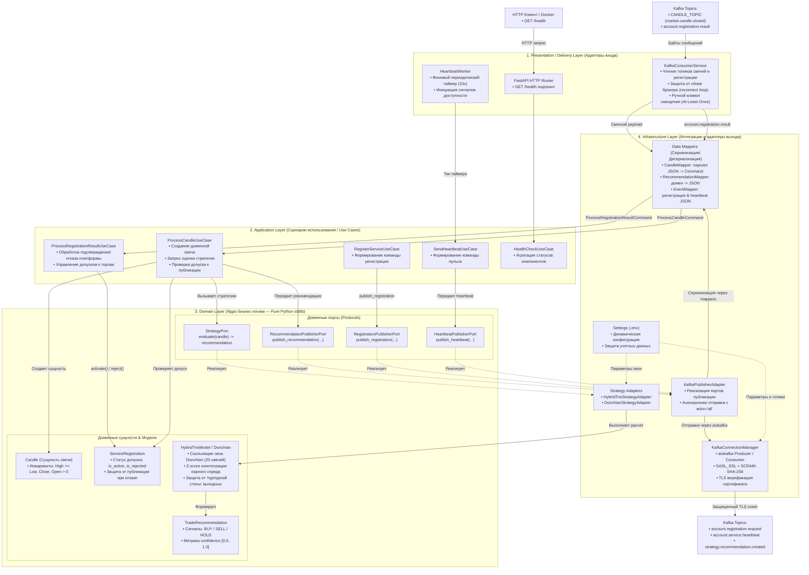

# Крупноузловая компонентная схема сервиса (Component Diagram)

Схема отображает внутренние компоненты микросервиса `breakout-strategy`, сгруппированные по слоям Domain-Driven Design (DDD), их зоны ответственности и основные потоки данных.

---

## Зоны ответственности компонентов

### 1. Presentation / Delivery Layer
- **`KafkaConsumerService`:** непрерывное получение сообщений из брокера Kafka по темам `CANDLE_TOPIC` и `account.registration.result`. Изолирует сетевые сбои: при падении или перезапуске брокера не завершает процесс, а ожидает доступности и восстанавливает подписку.
- **`HeartbeatWorker`:** автономный фоновый процесс, с заданной периодичностью отправляющий сигналы жизнедеятельности сервиса для платформы.
- **`FastAPI HTTP Router`:** легковесный веб-адаптер для опроса работоспособности (`GET /health`) внешними системами мониторинга.

### 2. Application Layer
- **`ProcessCandleUseCase`:** координирует цепочку обработки поступающей свечи: валидация, расчет стратегии, проверка статуса регистрации и отправка рекомендации.
- **`ProcessRegistrationResultUseCase`:** обрабатывает вердикт платформы. При отказе сохраняет понятную причину и блокирует публикацию рекомендаций. При успехе активирует флаг доступа.
- **`RegisterServiceUseCase`:** формирует запрос на регистрацию при запуске сервиса со стабильными метаданными студента и стратегии.
- **`SendHeartbeatUseCase` / `HealthCheckUseCase`:** обеспечивают наблюдаемость и диагностику компонентов.

### 3. Domain Layer (Ядро чистой архитектуры)
- **`Candle`:** инкапсулирует свойства свечи, гарантирует валидность цен и таймстемпа.
- **`TradeRecommendation`:** представляет результат анализа рынка (`BUY`, `SELL`, `HOLD`), границы ценового коридора и математическую уверенность `confidence`.
- **`ServiceRegistration`:** доменный агрегат состояния допуска к торгам. Содержит метод `can_publish_recommendations`.
- **`HybridTrioModel`:** доменный алгоритм, объединяющий статистический арбитраж на банковской паре `SBER` + `T` с импульсным пробоем каналов Дончяна на `OZON`. Защищен от фиктивных свечей выходного дня.
- **Порты (`StrategyPort`, `RecommendationPublisherPort`, `RegistrationPublisherPort`, `HeartbeatPublisherPort`):** абстрактные интерфейсы взаимодействия по принципу Dependency Inversion (DIP).

### 4. Infrastructure Layer
- **`KafkaConnectionManager`:** управление TLS-контекстом (проверка сертификата сервера `omsu.7bits.it`) и соединениями `aiokafka.AIOKafkaProducer` / `aiokafka.AIOKafkaConsumer`.
- **`KafkaPublisherAdapter`:** реализация доменных портов отправки сообщений в соответствующие топики Kafka.
- **`CandleMapper`, `RecommendationMapper`, `EventMapper`:** взаимная трансляция форматов платформы (включая общее поле `schemaVersion` и структуру событий) и внутренних DTO/сущностей.
- **`Settings`:** безопасная загрузка конфигурации из `.env` без раскрытия секретов.
