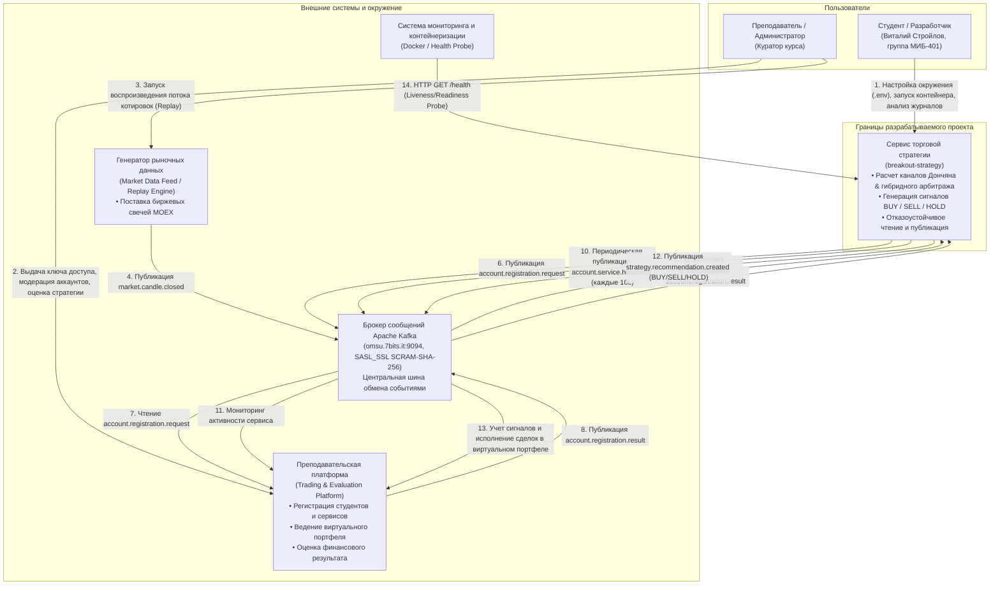

# Контекстная схема системы (Context Diagram)

Контекстная схема описывает границы сервиса торговой стратегии (`breakout-strategy`), его пользователей, внешние системы и протоколы взаимодействия.

---

## Описание взаимодействий

| № | Источник | Приемник | Протокол / Топик | Назначение и передаваемые данные |
| :- | :--- | :--- | :--- | :--- |
| **1** | Студент | `breakout-strategy` | CLI / Git / Docker | Конфигурирование параметров стратегии через `.env`, локальный запуск и просмотр структурированных логов. |
| **2** | Преподаватель | Платформа | Web UI / Admin API | Выдача персональной пары «ключ / секрет», согласование топика свечей, проверка списка зарегистрированных студентов. |
| **3** | Преподаватель | Candle Feed | Внутренний триггер | Запуск стенда Replay исторических срезов Мосбиржи. |
| **4** | Candle Feed | Kafka Broker | Kafka (`market.candle.default`) | Поставка потока сформированных дневных свечей (`market.candle.closed`). |
| **5** | Kafka Broker | `breakout-strategy` | Kafka (Consumer group `candles-student-key-05`) | Чтение свечей целевых тикеров (`SBER`, `T`, `OZON` и др.) с ручным подтверждением смещения (At-Least-Once). |
| **6-7**| `breakout-strategy` | Платформа | Kafka (`account.registration.request`) | Запрос регистрации при старте сервиса со стабильными идентификаторами (`secretKey`, `accountName`, `groupId`, `serviceName`, `strategyName`). |
| **8-9**| Платформа | `breakout-strategy` | Kafka (`account.registration.result`) | Ответ на запрос регистрации (`success: bool`, `reason: str`). При отказе сервис блокирует публикацию рекомендаций. |
| **10-11**| `breakout-strategy`| Платформа | Kafka (`account.service.heartbeat`) | Периодический сигнал жизнедеятельности сервиса (каждые 10 секунд). |
| **12-13**| `breakout-strategy`| Платформа | Kafka (`strategy.recommendation.created`) | Отправка торговых рекомендаций (`BUY`, `SELL`, `HOLD`) с указанием расчетных границ канала и метрики `confidence`. |
| **14**| Orchestrator | `breakout-strategy` | HTTP (`GET /health`) | Проверка состояния сервиса и доступности брокера Kafka. |

