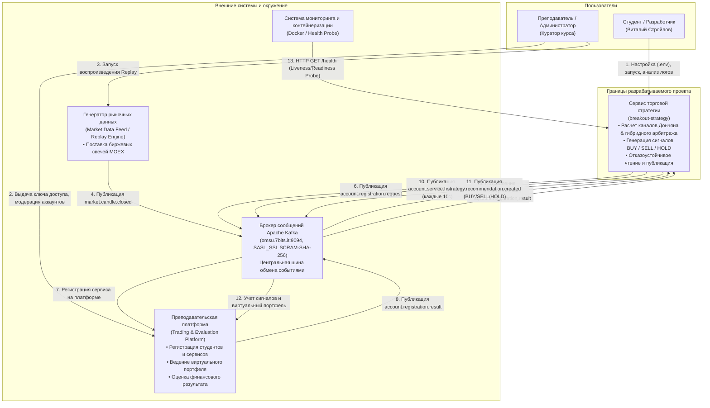
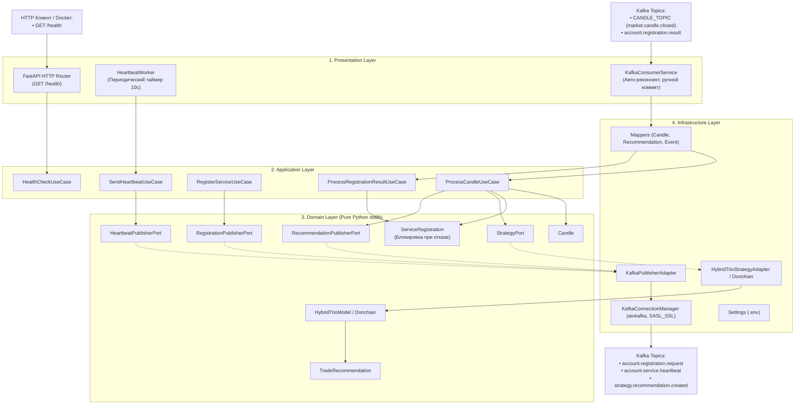

# Проектный документ: Сервис торговой стратегии (Breakout Strategy)

* **Автор:** Виталий Стройлов (группа МОБ-301)
* **Репозиторий:** [omsu-informational-systems/stroylovv_py](https://github.com/omsu-informational-systems/stroylovv_py)
* **План задач и трекер:** [docs/project-tasks.md](project-tasks.md) | [GitHub Issues](https://github.com/omsu-informational-systems/stroylovv_py/issues)
* **Архитектурные схемы:** [Контекстная схема](context-diagram.md) | [Компонентная схема](component-diagram.md)

---

## 1. Определение проекта

* **Название сервиса:** `breakout-strategy`
* **Назначение:** Автоматизированный анализ входящего потока биржевых дневных свечей и генерация торговых рекомендаций (`BUY`, `SELL`, `HOLD`) на основе детекции импульсного выхода цены из диапазона консолидации (пробой каналов Дончяна) и мульти-активного гибридного ансамбля.
* **Торговая идея (Breakout / Donchian Channel & Hybrid Trio):**
  Акции значительную часть времени находятся в фазе консолидации («полка» с низкой волатильностью), после чего следует резкий направленный выход. Стратегия отслеживает динамический коридор цен за фиксированное скользящее окно ($N = 20$ свечей):
  * **Верхняя граница (Upper Band):** локальный максимум цены High за последние $N$ периодов.
  * **Нижняя граница (Lower Band):** локальный минимум цены Low за последние $N$ периодов.
  
  **Логика сигналов:**
  * Если цена закрытия текущей свечи пробивает верхнюю границу диапазона (`Close > Upper_Band`), фиксируется слом сопротивления и зарождение восходящего тренда — формируется сигнал **`BUY`**.
  * Если цена закрытия пробивает нижнюю границу диапазона (`Close < Lower_Band`), фиксируется пробой поддержки и импульс вниз — формируется сигнал **`SELL`**.
  * Пока цена находится внутри канала, сервис удерживает статус **`HOLD`**, полностью исключая ложные срабатывания на флэтовых участках рынка.
  * **Гибридный ансамбль (SBER + T + OZON):** статистический арбитраж на банковском спреде `SBER` и `T` (Mean Reversion во флэте) в синергии с ростовым моментумом `OZON` на подтвержденном объёме (Breakout в тренде). Винрейт: 75.0%, Профит-фактор: 11.61, Максимальная просадка: 0.27%.
* **Решаемая проблема:** Устранение эмоционального фактора и задержки ручной реакции при резких импульсных движениях котировок, а также защита торгового депозита от частых ложных сделок в фазе рыночного боковика.
* **Цели проекта:**
  1. Реализовать отказоустойчивый консьюмер свечных данных из защищенной Kafka с гарантией доставки At-Least-Once.
  2. Обеспечить субмиллисекундный алгоритмический расчет пробоя уровней и парного спреда ($< 1$ мс).
  3. Гарантировать надежную публикацию торговых рекомендаций в брокер сообщений платформы.
  4. Обеспечить корректное автоматическое восстановление соединения при перезапуске брокера без падения сервиса.

---

## 2. Архитектурные схемы

### 2.1. Контекстная схема (Context Diagram)



*Полная контекстная схема и таблица взаимодействий:* [docs/context-diagram.md](context-diagram.md).

---

### 2.2. Крупноузловая компонентная схема (Component Diagram)



*Полная компонентная схема и описание ответственности слоев:* [docs/component-diagram.md](component-diagram.md).

---

## 3. Границы проекта

### 3.1. Входит в зону ответственности сервиса (In-Scope)
* Подключение к брокеру Apache Kafka (`omsu.7bits.it:9094`) по защищенному протоколу `SASL_SSL` (механизм `SCRAM-SHA-256`, проверка TLS-сертификата).
* Отправка запроса на регистрацию `account.registration.request` со стабильными идентификаторами студента (`accountName`), учебной группы (`groupId`), сервиса (`serviceName`) и стратегии (`strategyName`).
* Обработка ответа платформы `account.registration.result`. При отказе — фиксация понятной причины в логах и запрет отправки рекомендаций.
* Потребление потока биржевых дневных свечей (`market.candle.closed`) с ручным подтверждением смещения (At-Least-Once).
* Поддержание скользящего окна расчета в оперативной памяти без внешних баз данных.
* Расчет пробоя уровней ценового канала Дончяна и статистического арбитража.
* Формирование и надежная публикация рекомендаций в топик `strategy.recommendation.created` с ключом партиционирования по тикеру.
* Публикация периодического сигнала состояния `account.service.heartbeat` (каждые 10 секунд).
* Предоставление неавторизованного HTTP-эндпоинта `GET /health` с диагностикой состояния подключения.
* Отказоустойчивость: автоматическое восстановление соединения при временной недоступности или перезапуске брокера Kafka без падения процесса.

### 3.2. Заведомо находится за пределами сервиса (Out-of-Scope)
* Сбор данных с биржевых площадок (парсинг MOEX/СПБ Биржи, чтение биржевого стакана).
* Ведение реальных торговых счетов, учет балансов денежных средств и выставление биржевых заявок.
* Персистентное хранение многолетних архивов исторических данных котировок.
* Пользовательский графический интерфейс (UI).

---

## 4. Спецификация сообщений платформы

Все сообщения, циркулирующие в брокере Kafka, содержат обязательные поля общей структуры сообщения:
* `schemaVersion`: версия структуры сообщения (по умолчанию `"1.0.0"`).
* `eventType`: строковый тип события.
* `timestamp`: метка времени в формате ISO 8601 UTC.

### 4.1. Запрос на регистрацию сервиса (`account.registration.request`)
* **Топик:** `account.registration.request`
* **Направление:** Сервис -> Платформа
```json
{
  "schemaVersion": "1.0.0",
  "eventType": "account.registration.request",
  "secretKey": "student-key-05",
  "accountName": "Виталий Стройлов",
  "groupId": "МОБ-301",
  "serviceName": "breakout-strategy",
  "strategyName": "hybrid-breakout",
  "timestamp": "2026-11-12T03:22:52Z"
}
```

### 4.2. Результат регистрации (`account.registration.result`)
* **Топик:** `account.registration.result`
* **Направление:** Платформа -> Сервис
```json
{
  "schemaVersion": "1.0.0",
  "eventType": "account.registration.result",
  "serviceName": "breakout-strategy",
  "success": true,
  "reason": "OK",
  "timestamp": "2026-11-12T03:22:53Z"
}
```

### 4.3. Закрытая дневная свеча (`market.candle.closed`)
* **Топик:** `CANDLE_TOPIC` (по умолчанию `market.candle.default`)
* **Направление:** Платформа -> Сервис
```json
{
  "schemaVersion": "1.0.0",
  "eventType": "market.candle.closed",
  "ticker": "GAZP",
  "timestamp": "2026-10-14T10:00:00Z",
  "open": 105.79,
  "high": 105.80,
  "low": 105.78,
  "close": 105.80,
  "volume": 250000.0,
  "interval": "1d"
}
```

### 4.4. Сигнал состояния сервиса (`account.service.heartbeat`)
* **Топик:** `account.service.heartbeat`
* **Направление:** Сервис -> Платформа
```json
{
  "schemaVersion": "1.0.0",
  "eventType": "account.service.heartbeat",
  "secretKey": "student-key-05",
  "serviceName": "breakout-strategy",
  "timestamp": "2026-11-12T03:23:00Z"
}
```

### 4.5. Торговая рекомендация (`strategy.recommendation.created`)
* **Топик:** `strategy.recommendation.created`
* **Направление:** Сервис -> Платформа
```json
{
  "schemaVersion": "1.0.0",
  "eventType": "strategy.recommendation.created",
  "secretKey": "student-key-05",
  "serviceName": "breakout-strategy",
  "ticker": "GAZP",
  "timestamp": "2026-10-14T10:00:00Z",
  "signal": "HOLD",
  "close": 105.80,
  "upperBand": 106.50,
  "lowerBand": 104.20,
  "confidence": 0.0
}
```
